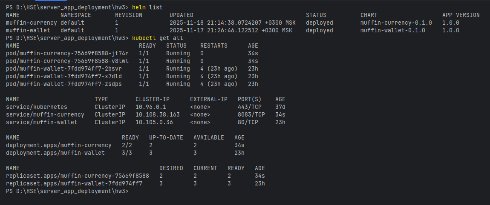
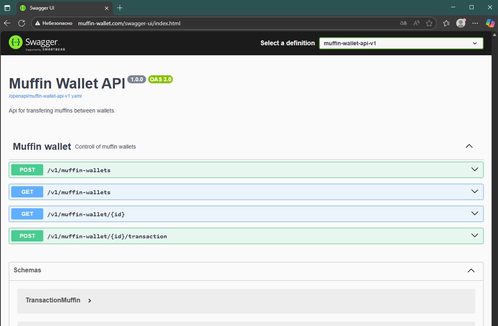

# Евсюков Александр БПИ224

## Задание
Необходимо создать похожую конфигурацию с основным приложением
muffin-wallet.

таким образом, у вас будут 2 helm chart с помощью которых вы сможете развернуть
muffin-wallet и muffin-currency

использование helmfile и hooks приветствуется.

Дедлайн: ВТ(18.11.2025) 23:59

## Шаги выполнения задания:
1. Переписал чарт для muffin-currency по комментариям с защиты
2. Создал новый чарт для muffin-wallet
3. Создал values файл на основе нового манифеста 
4. Сделал template'ы для нового чарта
5. Проверил шаблоны командой:
    ```bash
    helm lint muffin-wallet
    helm template muffin-wallet
    ```
6. Установил чарты в кластер командой:
    ```bash
    helm install muffin-currency muffin-currency
    helm install muffin-wallet muffin-wallet
   ```
7. Проверил установку командой:
    ```bash
    helm list
    kubectl get all
    helm status muffin-currency
    helm status muffin-wallet
    ```
   
8. Проверил работу muffin-wallet по ссылке:
    ```bash
    minikube tunnel
    ```
    И перешел по ссылке в браузере: http://muffin-wallet.com/ </br>
    

## Другие команды для работы с helm:
- `helm create muffin-chart` — команда для создания Helm-чарта
- `helm status muffin-release` — команда для просмотра статуса релиза
- `helm upgrade muffin-release muffin-chart` — команда для обновления релиза
- `kubectl get pods` — команда для проверки подов после обновления
- `helm rollback muffin-release 1` — команда для отката релиза
- `helm history muffin-release` — команда для просмотра истории релизов
- `helm uninstall muffin-release` — команда для удаления релиза
- `kubectl get all` — команда для проверки ресурсов после удаления